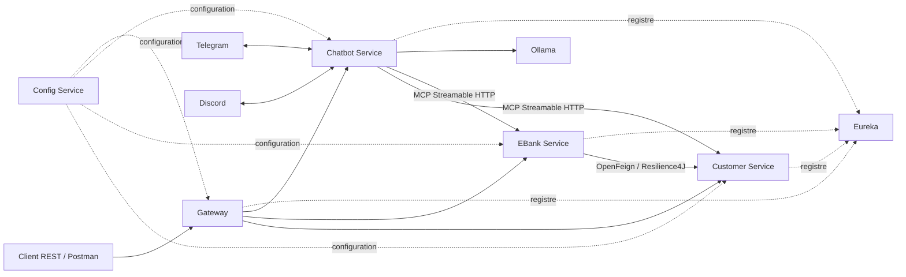

# Facturation et EBank — microservices

Application de facturation avec gestion des clients, catalogue de produits et client Angular. Le guide de demarrage est disponible dans [docs/invoicing.md](docs/invoicing.md). Lancer `scripts/Start-Billing.ps1` pour ouvrir l'application sur http://localhost:4200.

Technologies : Spring Boot **4.1.1**, Java **17+**, Spring Cloud **2025.1.3**, Spring AI **2.0.0**, Maven Wrapper **3.9.12**.

| Module | Port | Fonction |
| --- | --- | --- |
| discovery-service | 8761 | Registre Eureka |
| config-service | 8888 | Configuration centralisee, profil native, fichiers embarques |
| customer-service | 8081 | Clients, REST, JPA/H2 et serveur MCP |
| ebank-service | 8082 | Comptes, operations, OpenFeign, Resilience4J et serveur MCP |
| chatbot-service | 8083 | Agent Spring AI, client des deux serveurs MCP, Telegram et Discord |
| gateway-service | 8080 | Routes REST via Eureka et Spring Cloud Gateway |
| bank-common | — | Contrat client et erreurs HTTP ProblemDetail |
| inventory-service | 8084 | Catalogue produits, prix et stock |
| billing-service | 8085 | Factures multi-produits, OpenFeign et historique |
| frontend | 4200 | Client Angular de facturation |



## Demarrage sous Windows / PowerShell

Java 17 a 25 doit etre accessible dans PATH. Aucun Maven global n'est requis.

```powershell
.\mvnw.cmd -B -ntp verify

.\scripts\Start-Stack.ps1 -SkipBuild

.\scripts\Test-Stack.ps1

.\scripts\Stop-Stack.ps1
```

Sans -SkipBuild, Start-Stack execute aussi Maven verify. L'option -NoChatbot desactive le chatbot ; Test-Stack requiert le chatbot pour verifier MCP. Les services restent en arriere-plan jusqu'a Stop-Stack. Les clients Eureka peuvent mettre quelques secondes a connaitre les routes apres le demarrage.

Pour un lancement manuel, ouvrir un terminal par service et utiliser `java -jar <module>/target/<module>-0.0.1-SNAPSHOT.jar`, dans l'ordre du tableau. Sur Linux/macOS : `./mvnw verify`, puis les memes commandes java.

Les adresses ecoutees sont **127.0.0.1** par defaut. Le projet est une demonstration locale sans authentification ni autorisation bancaire ; utiliser seulement des donnees fictives. Le client Angular couvre les fonctionnalites de facturation. L'envoi d'e-mails n'est pas implemente.

## Modele IA

Lancer Ollama avec `ollama serve` si necessaire, puis telecharger un modele qui prend en charge les appels d'outils :

```powershell
ollama pull llama3.1:8b
$env:OLLAMA_MODEL = 'llama3.1:8b'
.\scripts\Start-Stack.ps1 -SkipBuild
.\scripts\Test-Stack.ps1 -Chat
```

Le modele n'est jamais telecharge automatiquement. Le chatbot demarre sans Ollama, mais /api/chat renvoie **503** si le modele est indisponible. Les serveurs MCP doivent etre demarres avant le chatbot, qui initialise ses connexions au demarrage. OLLAMA_BASE_URL et OLLAMA_MODEL configurent un autre serveur/modele Ollama.

```powershell
$response = Invoke-RestMethod http://localhost:8080/api/chat -Method Post -ContentType 'application/json' -Body '{"message":"Quels sont les comptes de Hassan ?"}'
$response.answer
$body = @{ message = 'Donne leurs soldes et devises'; conversationId = $response.conversationId } | ConvertTo-Json
Invoke-RestMethod http://localhost:8080/api/chat -Method Post -ContentType 'application/json' -Body $body
Invoke-RestMethod "http://localhost:8080/api/chat/$($response.conversationId)" -Method Delete
```

La memoire conserve les 20 derniers messages par conversation et au plus 1 000 conversations en RAM. Les identifiants REST sont des UUID aleatoires ; Telegram et Discord ont des espaces de conversation distincts. Cette separation ne remplace pas une authentification.

## REST et Swagger

- Eureka : http://localhost:8761
- Configuration : http://localhost:8888/ebank-service/default
- Swagger clients : http://localhost:8081/swagger-ui/index.html
- Swagger comptes : http://localhost:8082/swagger-ui/index.html
- Swagger chatbot : http://localhost:8083/swagger-ui/index.html
- Collection Postman : [postman/EBank.postman_collection.json](postman/EBank.postman_collection.json)

| Methode | Route via localhost:8080 | Utilisation |
| --- | --- | --- |
| GET | /api/customers?name=ima&page=0&size=20 | Recherche de clients |
| GET | /api/customers/{id} | Detail client |
| POST | /api/customers | Creation : name, email |
| PUT | /api/customers/{id} | Modification : name, email |
| GET | /api/accounts?customerId=1&page=0&size=20 | Comptes enrichis avec le client |
| GET | /api/accounts/{uuid} | Detail du compte |
| POST | /api/accounts | customerId, type, currency, balance |
| POST | /api/accounts/{uuid}/credit | amount et en-tete Idempotency-Key |
| POST | /api/accounts/{uuid}/debit | amount et en-tete Idempotency-Key |
| GET | /api/accounts/{uuid}/operations | Historique pagine |
| POST | /api/chat | message et conversationId optionnel |
| DELETE | /api/chat/{conversationId} | Effacer le contexte |
| GET | /api/tools | Outils MCP decouverts par le chatbot |

Les pages commencent a 0 ; size est compris entre 1 et 100. Les soldes utilisent BigDecimal avec deux decimales. Les credits/debits sont transactionnels avec verrou pessimiste, refus du decouvert et deduplication par (compte, Idempotency-Key). Reutiliser la cle avec un montant ou type different renvoie 409. Les devises sont des codes ISO 4217 valides. Types : CURRENT_ACCOUNT et SAVING_ACCOUNT.

Les donnees initiales sont fictives : Hassan (1), Imane (2), Mohamed (3). Le compte `11111111-1111-1111-1111-111111111111` de Hassan contient 12 500 MAD ; le compte `22222222-2222-2222-2222-222222222222` d'Imane contient 32 500 MAD ; le compte `33333333-3333-3333-3333-333333333333` de Hassan contient 900 EUR.

H2 est **en memoire** par defaut : clients, comptes et operations sont reinitialises au redemarrage. Pour conserver les donnees, creer .data puis definir CUSTOMER_DB_URL et BANK_DB_URL comme indique dans .env.example. SEED_DATA=false desactive les jeux initiaux sur les deux services. Les comptes de demonstration supposent les identifiants clients d'une base initiale vide.

Le fallback Resilience4J laisse les comptes consultables si Customer est arrete : le champ customer.available passe a false. La creation de compte est alors bloquee par un 503 pour eviter un client non valide. Un client inexistant renvoie 404. La suppression des clients/comptes et les virements inter-comptes ne sont pas exposes.

## MCP Streamable HTTP

Les endpoints sont http://localhost:8081/mcp et http://localhost:8082/mcp. Il s'agit de MCP JSON-RPC (initialisation, session, liste et appel d'outils), pas d'un GET REST classique.

| Serveur | Outils |
| --- | --- |
| Customer | searchCustomers(name, page), getCustomer(customerId) |
| EBank | listAccounts(customerId, page), getAccount(accountId), accountHistory(accountId, page) |

Pour listAccounts, customerId=0 selectionne tous les clients. Les pages MCP contiennent au plus 100 resultats. Les outils sont en consultation ; les ecritures passent par les endpoints REST. /api/tools expose les noms decouverts, qui peuvent etre prefixes par le client MCP.

Avec Node.js installe, lancer le MCP Inspector puis choisir Streamable HTTP et l'un des endpoints :

```powershell
npx -y @modelcontextprotocol/inspector
```

Un test d'integration Java effectue aussi une vraie initialisation MCP, tools/list et tools/call sur Customer. Le test du chatbot utilise le vrai adaptateur Spring AI Ollama et un serveur HTTP de modele simule qui demande un outil : il ne necessite aucun LLM installe.

Pour verifier tout le parcours avec les services reels sans installer de LLM, un simulateur explicite est fourni (Python 3 requis). Dans un premier terminal :

```powershell
python scripts/testing/ollama_mcp_stub.py --port 11435 --report .runtime/agent-smoke.json
```

Dans un second terminal, definir `$env:OLLAMA_BASE_URL = 'http://localhost:11435'`, lancer la stack puis `scripts/Test-Stack.ps1 -Chat`. Le simulateur demande toujours le compte de demonstration de Hassan et construit sa reponse a partir du resultat MCP ; il ne comprend pas les questions. Le rapport indique explicitement simulated_model=true. Arreter le simulateur avec Ctrl+C et supprimer cette variable d'environnement avant d'utiliser Ollama.

## Telegram

Creer un bot via BotFather, puis definir les variables **avant** de lancer le chatbot :

```powershell
$env:TELEGRAM_ENABLED = 'true'
$env:TELEGRAM_BOT_TOKEN = '<token du bot>'
```

Le connecteur utilise getUpdates en polling, sans URL publique. Aucun webhook ne doit etre configure pour ce bot. Ecrire au bot en conversation privee : /start, une question, puis /reset pour effacer la memoire. Les groupes et messages non textuels sont ignores. Les longues reponses sont decoupees. L'offset Telegram est en RAM : cette integration de demonstration ne garantit pas la livraison exactement une fois apres un redemarrage.

## Discord

Creer une application dans le portail developpeur Discord, recuperer son application ID et sa cle publique Ed25519. Configurer :

```powershell
$env:DISCORD_ENABLED = 'true'
$env:DISCORD_APPLICATION_ID = '<application id>'
$env:DISCORD_PUBLIC_KEY = '<cle publique hexadecimale>'
```

Le endpoint POST /integrations/discord/interactions verifie la signature et l'horodatage des requetes, repond a PING et differe immediatement les reponses /bank. Les reponses sont ephemeres et les mentions desactivees. L'execution du modele se fait sur un pool borne ; les reponses sont limitees a 2 000 caracteres.

Pour recevoir Discord, exposer uniquement cet endpoint par un tunnel HTTPS vers localhost:8083 ou via le Gateway et le configurer comme Interactions Endpoint URL. Une application qui reste liee a 127.0.0.1 peut recevoir les requetes d'un tunnel local ; ne pas exposer les autres API de demonstration.

Installer l'application dans un serveur de test avec le scope applications.commands. Enregistrer la commande uniquement lorsque vous etes pret :

```powershell
$env:DISCORD_BOT_TOKEN = '<token du bot>'
.\scripts\Register-DiscordCommand.ps1 -GuildId '<id serveur de test>'
```

Utiliser ensuite `/bank question: Quels sont les comptes de Hassan ?`. Le script d'enregistrement modifie Discord ; il n'est pas lance par le build ou le demarrage.

## Configuration et verification

.env.example sert d'exemple ; les fichiers .env ne sont pas charges automatiquement. Definir les variables dans le terminal de lancement. Aucun secret n'est stocke dans le code.

CONFIG_URL (defaut http://localhost:8888), DISCOVERY_URL (http://localhost:8761/eureka/), CUSTOMER_SERVICE_URL (vide : decouverte Eureka), CUSTOMER_MCP_URL et BANK_MCP_URL permettent de modifier les connexions. Les ports sont surchargeables par DISCOVERY_PORT, CONFIG_PORT, CUSTOMER_PORT, BANK_PORT, CHATBOT_PORT et GATEWAY_PORT. En cas de changement de port, modifier egalement les URL dependantes. SERVICE_HOST definit l'adresse annoncee a Eureka (127.0.0.1 par defaut). La configuration centralisee est optionnelle pour permettre les tests isoles ; les valeurs de secours essentielles sont locales.

`mvnw.cmd verify` couvre les validations REST, emails uniques, outils MCP reels, fallback en panne, montants invalides, decouvert, idempotence et concurrence, execution d'outil par Spring AI, isolation/reset des conversations et signatures Discord. Test-Stack verifie les processus reels, le routage Eureka, OpenFeign et la decouverte des deux serveurs MCP. Le test -Chat demande un modele local operationnel ou le simulateur explicite. Telegram/Discord necessitent les identifiants personnels et une verification manuelle depuis leurs clients. Voir le [compte rendu de verification](docs/verification.md).

References : [Spring Cloud](https://cloud.spring.io/), [Spring AI et versions Boot](https://docs.spring.io/spring-ai/reference/getting-started.html), [serveur MCP](https://docs.spring.io/spring-ai/reference/api/mcp/mcp-streamable-http-server-boot-starter-docs.html), [client MCP](https://docs.spring.io/spring-ai/reference/api/mcp/mcp-client-boot-starter-docs.html), [Ollama](https://docs.spring.io/spring-ai/reference/api/chat/ollama-chat.html), [Telegram Bot API](https://core.telegram.org/bots/api), [Discord Interactions](https://github.com/discord/discord-api-docs/blob/main/developers/interactions/overview.mdx).
